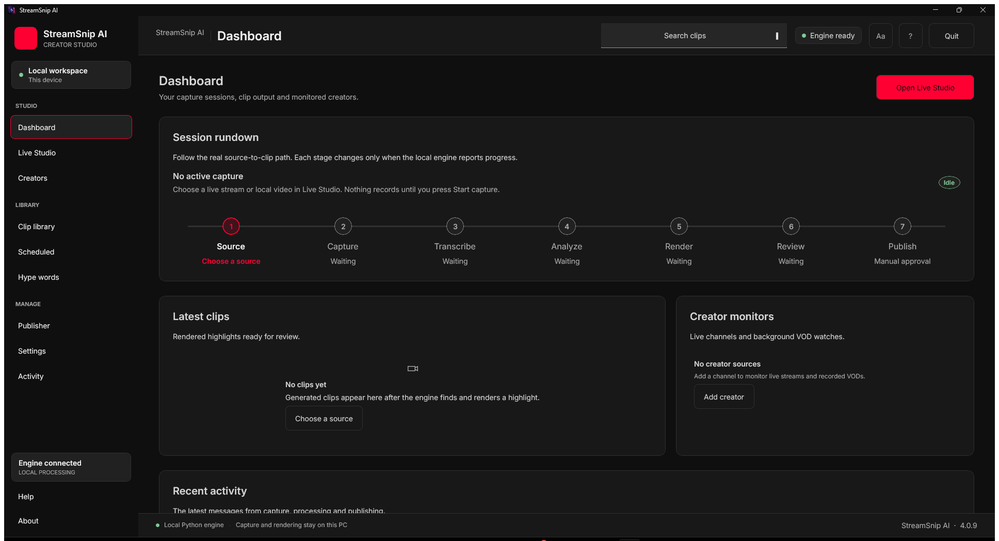
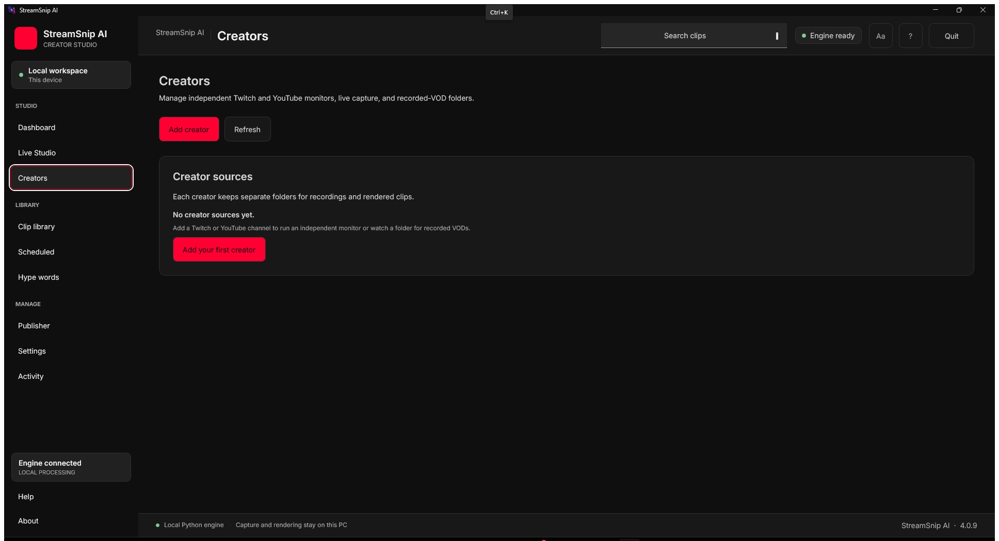

<div align="center">
  
  <p><strong>Capture the moment. Shape the clip. Review it. Publish when you are ready.</strong></p>
  <p>
    <a href="https://github.com/sifat-jaman-13/stream-clip-ai/releases/latest"></a>
    <a href="https://github.com/sifat-jaman-13/stream-clip-ai/actions/workflows/tests.yml"></a>
    <a href="https://github.com/sifat-jaman-13/stream-clip-ai/actions/workflows/build-installer.yml"></a>
    
    
    
  </p>
  <p>
    <a href="https://github.com/sifat-jaman-13/stream-clip-ai/releases/latest"><strong>Download for Windows</strong></a>
    | <a href="https://sifat-jaman-13.github.io/stream-clip-ai/">Project website</a>
    | <a href="docs/USER_GUIDE.md">Complete user guide</a>
    | <a href="https://github.com/sifat-jaman-13/stream-clip-ai/issues">Report a problem</a>
  </p>
</div>

## What it is

StreamSnip AI is a **native Windows creator studio** for turning supported Twitch and YouTube live streams, recorded VODs, and local videos into short-form clips. It brings capture, creator monitoring, local transcription, AI-assisted highlight selection, facecam-aware framing, animated captions, clip review, metadata, and controlled publishing into one workflow.

The installed desktop app uses **WinUI 3** with a supervised local Python media engine. The React/Vite dashboard in `dashboard/` is a separate browser-oriented frontend; it is not the installed native shell.

**Capture and publishing are always explicit actions.** Opening Live Studio does not start recording, and StreamSnip does not publish clips automatically.

## See the app

Screenshots below are from the **4.0.7 native Windows Release build**.

<p align="center">
  
</p>

<details>
  <summary><strong>View the other workspaces</strong></summary>
  <br>
  <table>
    <tr>
      <td width="50%">
        <p align="center"><strong>Live Studio</strong></p>
        
      </td>
      <td width="50%">
        <p align="center"><strong>Creator monitoring</strong></p>
        
      </td>
    </tr>
    <tr>
      <td width="50%">
        <p align="center"><strong>Clip Library</strong></p>
        
      </td>
      <td width="50%">
        <p align="center"><strong>Publishing</strong></p>
        
      </td>
    </tr>
  </table>
</details>

## Install on Windows

1. Open [GitHub Releases](https://github.com/sifat-jaman-13/stream-clip-ai/releases/latest).
2. Download `StreamSnipAI-Native-Setup.exe` and its matching `.sha256` file into the same folder.
3. Open PowerShell in that folder and verify the installer:

```powershell
$installer = '.\StreamSnipAI-Native-Setup.exe'
$checksum = "$installer.sha256"
$expected = ((Get-Content -LiteralPath $checksum -Raw).Trim() -split '\s+')[0].ToLowerInvariant()
$actual = (Get-FileHash -LiteralPath $installer -Algorithm SHA256).Hash.ToLowerInvariant()

if ($actual -ne $expected) {
    throw 'SHA-256 mismatch. Do not run this installer.'
}

Write-Host "SHA-256 verified: $actual"
```

4. Run the installer and launch StreamSnip AI from the Start menu or desktop shortcut.

The app supports Windows 10/11 x64. You do not need to install Python or FFmpeg globally; setup prepares an isolated runtime, reuses compatible components, and installs or repairs missing packages. Internet access is required when setup needs to download packages or model files.

The installer is currently unsigned, so Windows SmartScreen may show a publisher warning. Only continue if the installer came from the official release and its checksum matches.

## Quick start: first clip

1. **Check Dashboard.** Wait for the local engine to show that it is connected and ready.
2. **Choose a source.** In Live Studio, select Live stream for Twitch/YouTube or Video file / VOD for a local video. Paste the URL or use Browse video.
3. **Preview.** Press Preview source frame to verify the selected source. This is only a still-frame check.
4. **Configure.** Set Capture, AI provider, Transcription, and Captions in Live Studio before recording.
5. **Start.** Press Start capture. Follow the actual status and progress in Live Studio or Dashboard.
6. **Stop.** Press Stop capture when you are finished. Allow active work to stop gracefully.
7. **Review.** Open Clip Library, preview the MP4, and correct its title, description, and tags.
8. **Publish if wanted.** Configure Zernio in Publishing, choose a connected destination, review the post, and submit it yourself.

See the [complete user guide](docs/USER_GUIDE.md) for detailed setup, each setting, creator monitoring, publishing, storage, and troubleshooting.

## What to configure in Live Studio

Live Studio keeps the full pre-capture setup in one place.

| Tab | Main options |
| --- | --- |
| Capture | Chunk length, seconds before/after a highlight, minimum score, bitrate, and max clips per chunk |
| AI provider | Gemini, Ollama, OpenAI/ChatGPT API, Anthropic/Claude API, or custom OpenAI-compatible endpoint |
| Transcription | Faster-Whisper model, language, and CPU threads |
| Captions | Video layout, output ratio, subtitle mode/style, creator credit, creator tag, and profanity filter |

### AI providers

- **Gemini, OpenAI, and Claude** are hosted APIs. Use your own API key, model access, and quota.
- **Ollama** runs on the local service you configure and does not require a hosted AI API key.
- **Custom OpenAI-compatible API** can point to a compatible hosted or local endpoint.

The selected model analyzes transcript windows, selects candidate moments, and generates title, description, and topical tags. Use Test provider, then Save AI settings. Hosted providers receive transcript text for the task you choose; check their privacy and billing terms.

### Transcription and output

Faster-Whisper, FFmpeg rendering, OpenCV/YuNet, and local Hook Words processing run on your PC. Facecam framing uses **local multi-frame facecam detection** and may need manual review.

Supported output ratios are 9:16 portrait, 16:9 landscape, 1:1 square, and 4:5. Caption options include Karaoke and Classic modes, multiple styles, creator credit, and profanity filtering.

## Workspaces

| Workspace | Purpose |
| --- | --- |
| Dashboard | Session status, processing rundown, recent clips, creator activity, and engine events |
| Live Studio | Source selection and all pre-capture settings |
| Creators | Independent Twitch/YouTube monitors and recorded-VOD folder watching |
| Clip Library | Find, preview, and review generated clips and metadata |
| Published | Confirmed publishing records |
| Hype words | Local phrases used by the Hook Words scoring option |
| Publishing | Zernio connection, account discovery, and destination controls |
| Settings | Application-wide appearance and storage |
| Activity | Engine and workflow event history |
| Help & how-to | In-app quick start and troubleshooting |
| About | App version, architecture, source, and release links |

## Publishing and supported destinations

Publishing is optional and uses your configured Zernio integration. Connect Zernio, refresh the accounts it returns, enable the accounts you want to use, and select the intended destination for each post.

The current integration supports **Facebook, Instagram, and YouTube**. **TikTok is not a supported destination in this integration.** Account availability, upload limits, quotas, and posting errors are controlled by Zernio and the connected platforms. A destination is recorded as published only after success is confirmed.

Review every video and its metadata before posting. Highlight scores are suggestions, not guarantees of views or engagement.

## Local files and privacy

The installed app stores its local engine data under:

```
%LOCALAPPDATA%\StreamSnip AI\
```

Common folders include `out\` for generated clips, `rec\` for recordings and capture chunks, and `models\` for downloaded model files. Settings, provider configuration, creator profiles, publishing configuration, and logs are stored in the same local application-data area.

- Capture, transcription, facecam detection, rendering, and Hook Words are local.
- Ollama analysis stays on the local service you configure.
- Hosted AI receives transcript text for the task you request.
- Zernio receives selected media and post details when you publish.

The local API binds to loopback and uses a per-process session token for state-changing requests. **Do not expose it to an untrusted network or the public internet.** Never commit API keys, social tokens, cookies, or local browser profiles.

## Troubleshooting

- **Engine offline:** wait for startup; use runtime repair or rerun the latest installer and choose Repair. Check `%LOCALAPPDATA%\StreamSnip AI\setup.log` and `streamsnip.log`.
- **No source preview:** confirm the URL is supported and online, or verify the local file exists and opens in a media player.
- **No clips:** confirm the AI provider test succeeds, check the model/quota, lower an overly restrictive minimum score, and allow transcription/rendering to finish.
- **Slow transcription:** try a smaller Faster-Whisper model, ensure it is downloaded, and check available RAM/VRAM and disk space.
- **Publishing failure:** refresh connected accounts, check account enablement and provider quota, and inspect Activity for the destination result.

The [complete user guide](docs/USER_GUIDE.md) has step-by-step recovery instructions and more troubleshooting cases.

## Build from source

**Prerequisites:** Windows 10/11 x64, Python 3.10+, Node.js 22 with npm, .NET 10 SDK, Inno Setup 6, and FFmpeg.

```powershell
git clone https://github.com/sifat-jaman-13/stream-clip-ai.git
cd stream-clip-ai

python -m venv .venv
.venv\Scripts\Activate.ps1
python -m pip install --upgrade pip
python -m pip install -e ".[dev,live]"

cd dashboard
npm ci
npm run lint
npm run build
cd ..

.\build_native_installer.ps1
python -m pytest -q
```

The build script creates the dashboard bundle, publishes the self-contained `win-x64` WinUI 3 app, compiles the Inno Setup installer, and writes the installer plus SHA-256 sidecar under `dist\installer\`.

## Project information

- [Complete user guide](docs/USER_GUIDE.md)
- [Product overview](PRODUCT.md)
- [Design system](DESIGN.md)
- [Release history](CHANGELOG.md)
- [Contributing](CONTRIBUTING.md)
- [Security](SECURITY.md)
- [Third-party notices](licenses/third-party/)

### Licence

The project source is under the custom [Proprietary Non-Commercial Use Licence](LICENSE). It is **not** an OSI-approved open-source licence. Commercial use and public redistribution are not granted by this licence; obtain written permission from the applicable rights holders before either.

### Support

- [Open an issue](https://github.com/sifat-jaman-13/stream-clip-ai/issues)
- [Download releases](https://github.com/sifat-jaman-13/stream-clip-ai/releases)
- [Visit the project website](https://sifat-jaman-13.github.io/stream-clip-ai/)
