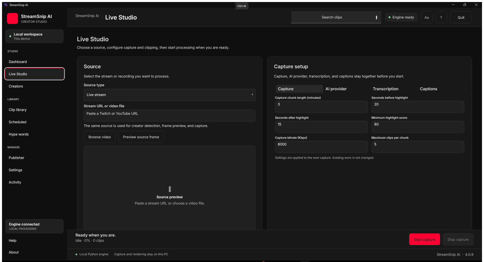

<div align="center">
  
  <p><strong>Capture the moment. Shape the clip. Review it. Publish when you are ready.</strong></p>
  <p>
    <a href="https://github.com/sifat-jaman-13/stream-clip-ai/releases/latest"></a>
    <a href="https://github.com/sifat-jaman-13/stream-clip-ai/actions/workflows/tests.yml"></a>
    <a href="https://github.com/sifat-jaman-13/stream-clip-ai/actions/workflows/build-installer.yml"></a>
    
    
    
  </p>
  <p>
    <a href="https://github.com/sifat-jaman-13/stream-clip-ai/releases/latest"><strong>Download for Windows</strong></a>
    | <a href="https://sifat-jaman-13.github.io/stream-clip-ai/">Project website</a>
    | <a href="https://github.com/sifat-jaman-13/stream-clip-ai/issues">Report a problem</a>
  </p>
</div>

## What it is

StreamSnip AI is a **native Windows creator studio** for turning supported Twitch and YouTube streams, recorded VODs, and local videos into short-form clips. It brings capture, creator monitoring, transcription, highlight analysis, facecam-aware framing, captioned rendering, clip review, and publishing into one workflow.

The installed app uses **WinUI 3** with a supervised local Python media engine. Your source files, recordings, transcription, framing, and rendering are handled on your PC. Hosted AI analysis and social publishing are optional services that you configure and invoke yourself.

## See the app

Screenshots below are from the **4.0.7 native Windows Release build**.

<p align="center">
  
</p>

<details>
  <summary><strong>View the other workspaces</strong></summary>
  <br>
  <table>
    <tr>
      <td width="50%">
        <p align="center"><strong>Live Studio</strong></p>
        
      </td>
      <td width="50%">
        <p align="center"><strong>Creator monitoring</strong></p>
        
      </td>
    </tr>
    <tr>
      <td width="50%">
        <p align="center"><strong>Clip Library</strong></p>
        
      </td>
      <td width="50%">
        <p align="center"><strong>Publishing</strong></p>
        
      </td>
    </tr>
  </table>
</details>

## From source to finished clip

1. **Choose a source.** Use a supported Twitch or YouTube live stream, a recorded VOD, or a local video.
2. **Capture or monitor.** Start and stop capture explicitly, or organise independent creators and their live/VOD workspaces.
3. **Transcribe and find moments.** Run Faster-Whisper locally and score candidate highlights with Hook Words, Ollama, or a hosted provider you configure.
4. **Frame and render.** Adjust facecam/gameplay framing, choose an output ratio, and render animated captions.
5. **Review and publish.** Check the clip and its generated metadata, then send selected posts through your connected Zernio destinations.

Opening Live Studio does **not** start recording. Capture begins only after you choose a source and explicitly start the session.

## Workspaces and output

| Workspace | Purpose |
| --- | --- |
| **Live Studio** | Configure source, capture, AI analysis, transcription, and captions before a session. |
| **Creators** | Keep creator profiles and their live and recorded-VOD monitoring separate. |
| **Clip Library** | Review rendered video with its matching title, description, and other post metadata. |
| **Published** | Keep confirmed published records separate from clips still under review. |
| **Publishing** | Manage Zernio connections, discover available accounts, and choose destinations per post. |

**Clip output:** portrait 9:16, landscape 16:9, square 1:1, and 4:5. Configure word-level animated captions, placement, creator credit, and supported styles. Facecam framing uses **local multi-frame facecam detection** with OpenCV and YuNet.

**Publishing destinations:** the current Zernio integration supports Facebook, Instagram, and YouTube. TikTok is not a supported destination in this integration. Posting availability and quotas are controlled by Zernio and the connected platforms. A destination is recorded as published only after success is confirmed.

Highlight scores are suggestions, not guarantees of views or engagement. Review every clip and its metadata before publishing.

## Install on Windows

1. Open [GitHub Releases](https://github.com/sifat-jaman-13/stream-clip-ai/releases/latest).
2. Download `StreamSnipAI-Native-Setup.exe` and its matching `.sha256` file into the same folder.
3. Open PowerShell in that folder and verify the installer:

```powershell
$installer = '.\StreamSnipAI-Native-Setup.exe'
$checksum = "$installer.sha256"
$expected = ((Get-Content -LiteralPath $checksum -Raw).Trim() -split '\s+')[0].ToLowerInvariant()
$actual = (Get-FileHash -LiteralPath $installer -Algorithm SHA256).Hash.ToLowerInvariant()

if ($actual -ne $expected) {
    throw 'SHA-256 mismatch. Do not run this installer.'
}

Write-Host "SHA-256 verified: $actual"
```

4. Run the installer and launch StreamSnip AI from the Start menu or desktop shortcut.

Setup prepares the self-contained WinUI 3 application and its isolated local engine. It checks for a compatible 64-bit Python runtime, FFmpeg/FFprobe, required packages, and the configured speech model. Compatible dependencies are reused; missing or incompatible components are installed or repaired. Setup does not replace system Python or change the global `PATH`.

An internet connection is needed when setup must download packages or model files. A Hugging Face token is optional and may help with gated or rate-limited model downloads. Setup diagnostics are written to `%LOCALAPPDATA%\StreamSnip AI\setup.log`.

## AI, privacy, and local processing

| Task | Where the work or data goes |
| --- | --- |
| Capture, recordings, local video, Faster-Whisper, OpenCV/YuNet, FFmpeg, and Hook Words | Your Windows PC |
| Local language-model analysis | Your configured Ollama service |
| Hosted AI analysis | Transcript text is sent to the provider you select for that task |
| Social publishing | Selected media and post details are sent to Zernio and the destinations you choose |

You can use local capture, transcription, rendering, Hook Words, and Ollama without a hosted AI API key. Optional analysis providers include Gemini, Hugging Face, OpenAI/ChatGPT, Anthropic/Claude, and a custom OpenAI-compatible endpoint. A selected hosted provider receives transcript text for the task you request; check its privacy and retention terms before connecting it.

The local FastAPI engine binds to loopback and uses a per-process session token for state-changing requests. **Do not expose the engine API to an untrusted network or the public internet.** Credentials are kept in local application settings and are not returned by the browser-facing status API. Never commit API keys, social tokens, cookies, or local browser profiles.

## Build from source

**Prerequisites:** Windows 10/11 x64, Python 3.10 or newer, Node.js 22 with npm, .NET 10 SDK, Inno Setup 6, and FFmpeg.

```powershell
git clone https://github.com/sifat-jaman-13/stream-clip-ai.git
cd stream-clip-ai

python -m venv .venv
.venv\Scripts\Activate.ps1
python -m pip install --upgrade pip
python -m pip install -e ".[dev,live]"

cd dashboard
npm ci
npm run lint
npm run build
cd ..

.\build_native_installer.ps1
python -m pytest -q
```

The build script creates the dashboard bundle, publishes the self-contained `win-x64` WinUI 3 application, compiles the Inno Setup installer, and writes the installer and SHA-256 sidecar under `dist\installer\`.

## Project information

- **Product overview:** [PRODUCT.md](PRODUCT.md)
- **Design system:** [DESIGN.md](DESIGN.md)
- **Release history:** [CHANGELOG.md](CHANGELOG.md)
- **Contributing:** [CONTRIBUTING.md](CONTRIBUTING.md)
- **Security:** [SECURITY.md](SECURITY.md)
- **Third-party notices:** [licenses/third-party/](licenses/third-party/)

### Licence

The project source is under the custom [Proprietary Non-Commercial Use Licence](LICENSE). It is **not** an OSI-approved open-source licence. Commercial use and public redistribution are not granted by this licence; obtain written permission from the applicable rights holders before either.

### Support

- [Open an issue](https://github.com/sifat-jaman-13/stream-clip-ai/issues)
- [Download releases](https://github.com/sifat-jaman-13/stream-clip-ai/releases)
- [Visit the project website](https://sifat-jaman-13.github.io/stream-clip-ai/)
