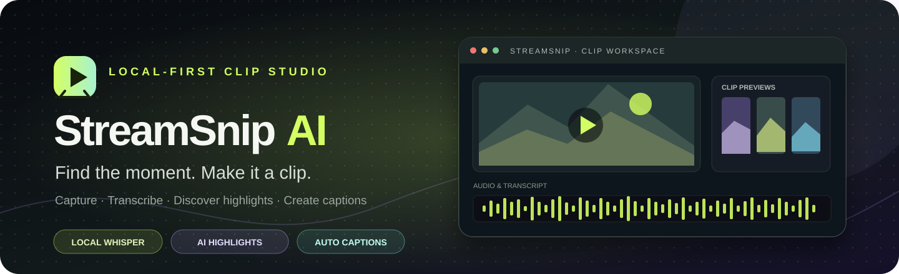

# StreamSnip AI

**A local-first Windows creator studio for capturing streams, finding standout moments, producing polished clips, and preparing social posts.**

[**Windows downloads**](https://github.com/sifat-jaman-13/stream-clip-ai/releases) · [**Project website**](https://sifat-jaman-13.github.io/stream-clip-ai/) · [**Report an issue**](https://github.com/sifat-jaman-13/stream-clip-ai/issues)

---

## What is StreamSnip AI?

StreamSnip AI turns live streams and recorded VODs into review-ready short-form videos. It connects source capture, creator monitoring, transcription, highlight analysis, facecam-aware framing, captioned rendering, metadata, and social publishing in one Windows desktop application.

The installed application uses a **native WinUI 3 interface** backed by a local Python media engine. The engine performs capture and processing on your computer and exposes its services through a loopback-only API. A React and TypeScript dashboard is also maintained for browser-oriented development and workflows.

StreamSnip is local-first, not cloud-only. Video files, recordings, rendering, local transcription, and application data remain on your device. Hosted AI services receive transcript text only when you choose and configure them. Publishing is an explicit operation through your own Zernio connection.

## The workflow

~~~mermaid
flowchart LR
    A["Twitch / YouTube live"] --> C["Capture & recordings"]
    B["Local video / VOD"] --> D["Transcription"]
    C --> D
    D --> E["Highlight analysis"]
    E --> F["Framing & clip render"]
    F --> G["Review & metadata"]
    G --> H["Zernio"]
    H --> I["Facebook"]
    H --> J["Instagram"]
    H --> K["YouTube"]
~~~

## Capabilities

| Area | What you can do |
| --- | --- |
| **Capture** | Capture supported Twitch and YouTube live streams or process local video files and recorded VODs. |
| **Creator monitoring** | Monitor saved creators independently and keep each creator's recordings, clips, VOD inbox, processed originals, and failures organised. |
| **Transcription** | Use local Faster-Whisper or configure a compatible command-line transcriber. |
| **Highlight analysis** | Score moments with local Hook Words, a local Ollama model, or a configured hosted AI provider. |
| **Facecam framing** | Detect facecam regions locally with OpenCV and YuNet, then tune the facecam and gameplay crops. |
| **Clip rendering** | Produce portrait, landscape, square, and 4:5 outputs with FFmpeg. |
| **Captions** | Configure animated word-level captions, placement, creator credit, subtitle styling, and profanity handling. |
| **Metadata** | Generate transcript-grounded titles, descriptions, hashtags, and text sidecars for review. |
| **Publishing** | Discover social accounts through Zernio, choose destinations per account, and track destination-level outcomes. |

Highlight scores are estimates, not guarantees of views, reach, or engagement. Review every generated clip and its metadata before publishing.

## Publishing with Zernio

StreamSnip supports these Zernio destinations:

- **Facebook**
- **Instagram**
- **YouTube**

TikTok is not currently supported by this integration.

Connect one or more Zernio API keys, save the connections, and let StreamSnip discover the Facebook, Instagram, and YouTube accounts available to each key. Each discovered account has its own posting switch. You can choose one or several accounts for an individual clip or a batch.

**Zernio controls request and platform limits.** StreamSnip does not impose a connection-count cap, per-platform account slots, or posting quotas. Different API keys can still belong to the same Zernio billing workspace and share its request allowance; a second key is not a separate quota. Zernio exposes an API-user identity, but not a stable billing-workspace identifier that lets StreamSnip prove that different keys are independent.

Publishing results are evaluated per destination. A partially successful post only records destinations that report a successful outcome. Workspace request throttling is handled separately from an account-specific posting cap; an ambiguous platform error does not automatically disable an account. Retry attempts reuse the same idempotency key for the same logical post.

Publishing creates an external side effect. Testing account discovery and read-only status is different from testing a real publish. Do not run a live post unless you intend to create a public or scheduled post.

## Local processing, AI providers, and privacy

| Capability | Processing boundary |
| --- | --- |
| Stream capture and VOD processing | Runs through the local engine. Internet access is required for live sources and downloads. |
| FFmpeg rendering and YuNet detection | Runs locally on your computer. |
| Faster-Whisper | Runs locally with a compatible Python environment and speech model. |
| Hook Words scoring | Local analysis; no hosted AI key is required. |
| Ollama | Uses a reachable local Ollama service and selected model. |
| Gemini, Hugging Face, or custom chat-completions API | Sends transcript text to the provider you configure for the requested analysis or copy-generation task. |
| Social publishing | Sends the media and post details to Zernio and the selected social platform destination. |

Credentials are stored in local application settings and are not returned to the browser interface. The local API uses loopback access and session-token protection for state-changing requests. **Do not expose the local API directly to an untrusted LAN or the public internet.**

Use Hook Words or a local Ollama model when you do not want transcript text sent to a hosted AI provider. Review each provider's own privacy and retention terms before connecting it.

## Install on Windows

1. Open [GitHub Releases](https://github.com/sifat-jaman-13/stream-clip-ai/releases).
2. Select a release whose assets include the native installer **StreamSnipAI-Native-Setup.exe**. Older releases may contain only the legacy Python launcher.
3. Download the matching SHA-256 file and verify the installer checksum.
4. Run the installer and complete its one-time engine setup.
5. Launch StreamSnip AI from the Start menu or desktop shortcut.

The native installer packages the WinUI 3 desktop application and the Python engine source. During setup, StreamSnip prepares an app-managed Python runtime, compatible dependencies, FFmpeg, and the required speech models. This first setup needs an internet connection and can take longer while packages and models are downloaded. It does not replace an existing system Python or change the global PATH.

The installed native application stores its local engine configuration and library under the user's local application data folder. Keep this folder backed up if it contains clips or other data you want to preserve.

The Windows installer is currently unsigned. Windows may display a SmartScreen or publisher warning. Verify the installer checksum and review the release before running it.

> The release workflow uploads the native installer as a build artifact and attaches it to GitHub Releases when run for a version tag. The native asset is not retroactively added to older releases; check the release assets before downloading.

## Run from source

### Requirements

- Windows 10 or Windows 11, 64-bit, for the primary desktop workflow.
- Python 3.12 recommended for source development; the installer supports stable 64-bit Python 3.10 and later. Python 3.15 is supported with a special Faster-Whisper setup that omits the optional ONNX Runtime VAD component because VAD is not enabled by the application; standard transcription remains available.
- Node.js 22 and npm for the React dashboard.
- .NET 10 SDK for building the WinUI 3 desktop application.
- FFmpeg available on PATH for source-based development.
- Internet access for live capture, package installation, model downloads, and hosted integrations.

### 1. Clone and prepare Python

Run from the repository root:

~~~powershell
git clone https://github.com/sifat-jaman-13/stream-clip-ai.git
cd stream-clip-ai

py -3.12 -m venv .venv
.\.venv\Scripts\Activate.ps1

python -m pip install --upgrade pip
python -m pip install -r requirements.txt
python -m pip install "pytest>=8"
~~~

### 2. Build the browser dashboard

~~~powershell
Set-Location .\dashboard
npm ci
npm run lint
npm run build
Set-Location ..
~~~

### 3. Run the native WinUI 3 desktop app

From the repository root, point the native host at the source checkout and its Python environment:

~~~powershell
$env:STREAMSNIP_SOURCE_DIR = (Get-Location).Path
$env:STREAMSNIP_PYTHON = (Join-Path (Get-Location).Path ".venv\Scripts\python.exe")

dotnet run --project .\desktop\StreamSnip.Desktop\StreamSnip.Desktop.csproj
~~~

The native host starts the Python engine as a child process, waits for its loopback API to become ready, and then loads the desktop workspace. Debug data is isolated under the user's local application data folder in StreamSnip AI/native-development.

### Browser-oriented dashboard development

The React dashboard can also be run separately during frontend development. Use two PowerShell terminals.

**Terminal 1 — local Python engine**

~~~powershell
$env:STREAMSNIP_PORT = "8204"
.\.venv\Scripts\python.exe .\autoclip.py
~~~

**Terminal 2 — Vite development server**

~~~powershell
Set-Location .\dashboard
npm run dev
~~~

Open http://127.0.0.1:5173/dashboard/. Vite proxies /api and /clips to the local Python engine on port 8204. Keep this local service bound to loopback.

## Build the Windows installer

The release build uses the native WinUI 3 project and Inno Setup 6. On Windows, install the .NET 10 SDK, Node.js 22, and Inno Setup 6, then run from the repository root:

~~~powershell
.\build_native_installer.ps1
~~~

The script builds and lints the dashboard, prepares the licensed JetBrains Mono font when needed, publishes the self-contained WinUI 3 application for win-x64, compiles the installer, and writes a SHA-256 checksum.

Output:

~~~text
dist\installer\StreamSnipAI-Native-Setup.exe
dist\installer\StreamSnipAI-Native-Setup.exe.sha256
~~~

The CI release workflow runs the same native installer build for version tags and manual workflow dispatches.

## Tests and quality checks

Run the Python suite from the repository root:

~~~powershell
python -m py_compile autoclip.py api_server.py ai_highlights.py post_metadata.py zernio_poster.py zernio_connections.py facecam_detect.py
python -m pytest -q
~~~

Run frontend checks from the dashboard folder:

~~~powershell
npm run lint
npm run build
~~~

Build the WinUI 3 project on Windows:

~~~powershell
dotnet restore .\desktop\StreamSnip.Desktop\StreamSnip.Desktop.csproj
dotnet build .\desktop\StreamSnip.Desktop\StreamSnip.Desktop.csproj --no-restore
~~~

For installer changes, run build_native_installer.ps1. Do not use real social accounts for automated publishing tests. Use local mocks for upload and publishing request tests unless a live post is explicitly intended.

## Repository layout

~~~text
stream-clip-ai/
├── autoclip.py                 Python engine, capture and media orchestration
├── api_server.py               Loopback FastAPI transport and request protection
├── ai_highlights.py            Local and hosted highlight-analysis providers
├── post_metadata.py            Transcript-grounded social copy
├── zernio_poster.py            Zernio API client and publish-result parsing
├── zernio_connections.py       Multi-key discovery and account-level controls
├── facecam_detect.py           Local facecam detection helpers
├── assets/                     Shared branding and application assets
├── models/                     Bundled YuNet face-detection model
├── dashboard/                  React, TypeScript, and Vite browser dashboard
├── desktop/StreamSnip.Desktop/ WinUI 3 native Windows desktop host
├── installer/                  Native setup, engine preparation, and uninstall
├── tests/                      Python regression and integration tests
├── docs/                       Public GitHub Pages website
└── .github/workflows/          Tests, site deployment, and release packaging
~~~

The Docker files provide an optional self-hosted Python/browser workflow. Docker does not package the native WinUI 3 desktop host and is not the primary Windows installation route.

## Troubleshooting

| Problem | What to check |
| --- | --- |
| Native desktop cannot start the engine | Run the installed setup/repair step and confirm native-engine.json points to the installed source and Python runtime. |
| Engine unavailable | Confirm the Python child process starts and review the local diagnostic log under the StreamSnip AI folder in local application data. |
| Missing video preview | Confirm the clip still exists in the configured library and the local engine is running. |
| Capture or rendering fails | Check source availability, FFmpeg, free disk space, and the Activity log. |
| AI request fails | Check the selected provider, model, endpoint, credential, and network access. |
| Zernio account is unavailable | Refresh account discovery and check the account's connection and provider status in Publishing. |
| Zernio returns a rate limit | Determine whether it is a workspace request throttle, an account-specific posting cap, or an upstream platform limit. Different API keys may share the same billing-workspace allowance. |

For security issues, follow SECURITY.md and use private vulnerability reporting instead of opening a public issue.

## Project links

- [GitHub repository](https://github.com/sifat-jaman-13/stream-clip-ai)
- [Windows releases](https://github.com/sifat-jaman-13/stream-clip-ai/releases)
- [Project website](https://sifat-jaman-13.github.io/stream-clip-ai/)
- [Issues and bug reports](https://github.com/sifat-jaman-13/stream-clip-ai/issues)
- [Changelog](CHANGELOG.md)
- [Security policy](SECURITY.md)

## License

StreamSnip AI is released under a **Proprietary Non-Commercial Use Licence**. It is source-available, not open source. The licence permits personal, private, and individual educational use under its terms. Commercial use, paid services, organisational use, and public redistribution require prior written permission from the applicable copyright holder(s).

Read LICENSE before using or redistributing the software. Third-party notices for bundled components are provided in LICENSE-NeonClipping.txt and LICENSE-YuNet.txt; their separate licence terms remain in effect.

**Find the moment. Make it a clip.**

Built by [Sifat Jaman / ScarZero](https://github.com/sifat-jaman-13).

