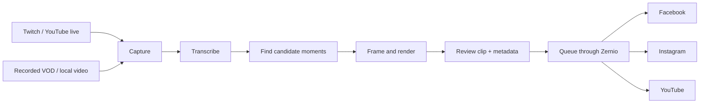

<div align="center">


# StreamSnip AI

### A native Windows clip studio for live creators.

<p>
  <a href="https://github.com/sifat-jaman-13/stream-clip-ai/releases/latest"></a>
  <a href="https://github.com/sifat-jaman-13/stream-clip-ai/actions/workflows/tests.yml"></a>
  <a href="https://github.com/sifat-jaman-13/stream-clip-ai/actions/workflows/build-installer.yml"></a>
  
  
  
</p>

[**Download for Windows**](https://github.com/sifat-jaman-13/stream-clip-ai/releases/latest) · [Website](https://sifat-jaman-13.github.io/stream-clip-ai/) · [Issues & support](https://github.com/sifat-jaman-13/stream-clip-ai/issues)

</div>

---

## What StreamSnip does

StreamSnip AI brings the stream-to-clip workflow into one native Windows application. Capture supported Twitch and YouTube sources, process recorded VODs or local video, transcribe speech, identify candidate highlights, render clips, review their metadata and prepare posts through your connected Zernio destinations.

The desktop application is built with **WinUI 3** and works with a supervised local Python media engine. Capture, transcription, framing, caption rendering and video export run on your PC. Optional hosted AI providers are explicit choices—not a requirement for the local media pipeline.

## Contents

- [What StreamSnip does](#what-streamsnip-does)
- [The app](#the-app)
- [The workflow](#the-workflow)
- [Main workspaces](#main-workspaces)
- [Capabilities](#capabilities)
- [Install on Windows](#install-on-windows)
- [AI providers and data handling](#ai-providers-and-data-handling)
- [Local-first architecture](#local-first-architecture)
- [Build from source](#build-from-source)
- [Repository map](#repository-map)
- [Licence and third-party notices](#licence-and-third-party-notices)
- [Support](#support)

## The app

These are real screenshots captured from the **4.0.7 native Windows Release build** while the local engine was connected. They show the actual application, not mockups. Normal empty states are shown where no sources or clips have been added yet.

<table>
  <tr>
    <td width="50%"><strong>Dashboard</strong><br></td>
    <td width="50%"><strong>Live Studio</strong><br></td>
  </tr>
  <tr>
    <td width="50%"><strong>Creator monitoring</strong><br></td>
    <td width="50%"><strong>Clip library</strong><br></td>
  </tr>
  <tr>
    <td width="50%"><strong>Publishing</strong><br></td>
    <td width="50%"></td>
  </tr>
</table>

## The workflow



A capture does not start just because Live Studio is open. You choose a source and explicitly start the session. The dashboard and Activity view then show the stages reported by the local engine.

## Main workspaces

### Live Studio

Choose a supported Twitch or YouTube live source, a recorded VOD, or a local video file. Configure capture, transcription, analysis, framing and caption options before starting. Live capture reconnects when a stream drops, and a graceful stop lets clips already captured finish processing.

### Creator monitoring

Save channels independently and monitor live streams or recorded VODs in the background. Each creator has its own workspace and separate Live and Recorded VOD folders, keeping different sources from collapsing into one queue.

### Clip library

Review rendered video alongside its matching post metadata. Preview, download, copy metadata, delete individual items or manage selections in bulk. Work still under review stays separate from records confirmed as published.

### Publishing

Connect one or more Zernio API keys, discover the social accounts available to each connection, and choose destinations for a clip or batch. Results are tracked per destination, so partial success and failure remain visible.

## Capabilities

| Area | What it does |
| --- | --- |
| Live capture | Capture supported Twitch and YouTube live sources with explicit start and stop controls. |
| Creator monitoring | Monitor saved creators independently and organise their Live and Recorded VOD folders. |
| VOD and local video | Process recorded VODs and supported local files through the same clipping workflow. |
| Transcription | Run Faster-Whisper locally or configure a compatible command-line transcriber. |
| Highlight analysis | Use built-in Hook Words, local Ollama, Gemini, Hugging Face, OpenAI / ChatGPT, Anthropic / Claude, or a custom OpenAI-compatible endpoint. |
| Facecam framing | Use local multi-frame facecam detection with OpenCV and YuNet; inspect and adjust facecam and gameplay regions before rendering. |
| Output formats | Render portrait 9:16, landscape 16:9, square 1:1 and 4:5 clips. |
| Captions | Configure animated word-level captions, placement, creator credit, styles and optional profanity handling. |
| Metadata | Generate transcript-grounded titles, descriptions, hashtags and matching text sidecars. |
| Publishing | Publish through configured Zernio connections to Facebook, Instagram and YouTube. |
| Clip lifecycle | Keep active clips and confirmed published records in separate areas with individual and bulk management. |

Highlight scores are estimates—not guarantees of views, reach or engagement. Always review the video and generated metadata before publishing.

## Install on Windows

1. Open [GitHub Releases](https://github.com/sifat-jaman-13/stream-clip-ai/releases/latest).
2. Download **StreamSnipAI-Native-Setup.exe** and its matching **.sha256** file into the same folder.
3. Open PowerShell and run the following check from that folder. This example uses your Downloads folder; change the path if you saved the files elsewhere.
4. Run the installer only after the check prints a successful verification.
5. Launch StreamSnip AI from the Start menu or desktop shortcut.

```powershell
$ErrorActionPreference = 'Stop'
Set-Location "$env:USERPROFILE\Downloads"

$installer = Join-Path (Get-Location) 'StreamSnipAI-Native-Setup.exe'
$checksumFile = "$installer.sha256"

if (-not (Test-Path -LiteralPath $installer -PathType Leaf)) {
    throw "Installer not found: $installer"
}
if (-not (Test-Path -LiteralPath $checksumFile -PathType Leaf)) {
    throw "SHA-256 file not found: $checksumFile"
}

$checksumText = Get-Content -LiteralPath $checksumFile -Raw -ErrorAction Stop
if ($checksumText -notmatch '^\s*([0-9a-fA-F]{64})(?:\s+.*)?\s*$') {
    throw 'The SHA-256 file does not contain a valid 64-character hash.'
}
$expected = $Matches[1].ToLowerInvariant()
$actual = (Get-FileHash -LiteralPath $installer -Algorithm SHA256 -ErrorAction Stop).Hash.ToLowerInvariant()

if ($actual -ne $expected) {
    throw "SHA-256 mismatch. Do not run this installer. Expected $expected; received $actual."
}
"SHA-256 verified: $actual"
```

The check stops if either file is missing or unreadable, validates the checksum format, and prints success only after the installer hash matches the sidecar.

### What setup prepares

The installer deploys the self-contained WinUI 3 application and the local Python engine source. During installation or repair, it checks for:

- A compatible 64-bit Python runtime and an isolated, app-managed environment.
- FFmpeg and FFprobe.
- Required Python packages and Windows-compatible wheels.
- The configured Faster-Whisper speech model files.
- The bundled face-detection model used by local facecam detection.

Python 3.15 uses a dedicated dependency profile that omits the optional ONNX Runtime VAD dependency when a compatible wheel is unavailable. Faster-Whisper continues using the supported transcription fallback; this does not disable the separate OpenCV/YuNet facecam detector.

Existing compatible dependencies and model files are reused. Missing or incompatible components are installed or repaired. Setup does not replace system Python or change the global PATH.

An internet connection is needed when setup must download packages or model files. A Hugging Face token is optional and may improve download reliability for gated or rate-limited model downloads.

Setup diagnostics are written to:

```text
%LOCALAPPDATA%\StreamSnip AI\setup.log
```

## AI providers and data handling

### Transcription and highlight analysis

Local capture, local transcription and rendering do not require a hosted AI API key. Choose the analysis path that fits your machine and workflow.

| Provider | Purpose | Where it runs |
| --- | --- | --- |
| Faster-Whisper | Speech-to-text | Locally on this PC |
| Custom transcriber | Use your own executable or script that returns timestamped output | Locally on this PC |
| Built-in Hook Words | Transcript-based highlight scoring | Locally on this PC |
| Ollama | Language-model highlight analysis | Your configured local Ollama service |
| Gemini / Hugging Face | Optional hosted highlight analysis | Provider service you configure |
| OpenAI / ChatGPT and Anthropic / Claude | Optional hosted highlight analysis | Provider service you configure |
| Custom OpenAI-compatible endpoint | Bring a compatible chat-completions API | Endpoint you configure |

A selected hosted provider receives transcript text for the requested analysis task. Check the provider's privacy, data-handling and retention terms before connecting it. Local video processing does not mean that every optional cloud feature is local.

### Zernio publishing

The current publishing integration supports these Zernio destinations:

- **Facebook**
- **Instagram**
- **YouTube**

TikTok is not a supported destination in the current integration.

Add your Zernio API key or keys in Publishing. StreamSnip discovers the accounts returned by each connection and lets you enable or disable accounts individually.

Zernio and the connected social platforms control account availability, request budgets and posting quotas. Different API keys may still belong to one Zernio billing workspace and share its request allowance; another key does not guarantee another quota. Only destinations confirmed as successful are recorded as published. Retries reuse the same idempotency key for the same logical post to reduce duplicate-post risk.

## Local-first architecture

| Operation | Execution |
| --- | --- |
| Capture and stream handling | Local Windows PC |
| Video files and recordings | Local Windows PC |
| Faster-Whisper transcription | Local Windows PC |
| Facecam detection and crop analysis | Local Windows PC |
| FFmpeg rendering and captions | Local Windows PC |
| Built-in Hook Words | Local Windows PC |
| Ollama | Local service you configure |
| Hosted AI analysis | Selected provider receives transcript text for that task |
| Zernio publishing | Selected media and post details are sent to Zernio and selected destinations |

The local FastAPI engine binds to loopback and uses a per-process session token for state-changing requests. **Do not expose the engine API to an untrusted network or the public internet.**

Credentials are stored in local application settings and are not returned by the browser-facing status API. Never commit environment files, API keys, social tokens, cookies or local browser profiles.

## Build from source

### Prerequisites

- Windows 10/11 x64.
- Python 3.10 or newer (the installer and build scripts validate compatibility).
- Node.js 22 and npm for the dashboard bundle.
- .NET 10 SDK for the WinUI 3 desktop application.
- Inno Setup 6 for the per-user Windows installer.
- FFmpeg for local media processing and tests that exercise media operations.

### Development setup

```powershell
git clone https://github.com/sifat-jaman-13/stream-clip-ai.git
cd stream-clip-ai

python -m venv .venv
.venv\Scripts\Activate.ps1
python -m pip install --upgrade pip
python -m pip install -e ".[dev,live]"
```

Build the dashboard:

```powershell
cd dashboard
npm ci
npm run lint
npm run build
cd ..
```

Build and package the native Windows application:

```powershell
.\build_native_installer.ps1
```

The script builds the dashboard, publishes the self-contained WinUI 3 application for win-x64, compiles the Inno Setup installer and generates a matching SHA-256 sidecar under `dist\installer\`.

### Tests

```powershell
python -m pytest -q
```

Run a focused test file:

```powershell
python -m pytest tests\test_native_installer_setup.py -q
```

## Repository map

```text
.
├── desktop/                  Native WinUI 3 desktop application
├── dashboard/                React + TypeScript engine dashboard bundle
├── installer/                Inno Setup and Windows setup/repair scripts
├── docs/                     GitHub Pages site and product screenshots
├── licenses/                 Third-party notices
├── models/                   Bundled face-detection model asset
├── tests/                    Python regression and integration tests
├── autoclip.py               Capture, processing, rendering and local API host
├── api_server.py             Local FastAPI engine integration
├── ai_highlights.py          Highlight-analysis providers
├── post_metadata.py          Transcript-grounded post metadata
├── zernio_connections.py     Zernio key and account discovery
└── zernio_poster.py          Zernio publishing integration
```

## Licence and third-party notices

The project source is distributed under the custom **Proprietary Non-Commercial Use Licence** in [LICENSE](LICENSE). It is **not** an OSI-approved open-source licence. Commercial use and public redistribution of project code are not granted by that licence; obtain written permission from the applicable rights holders before doing either.

Third-party libraries, model weights and bundled fonts retain their own licences. Their notices are collected under [licenses/third-party/](licenses/third-party/). The YuNet notice applies to the bundled model file only; it does not describe or claim ownership of StreamSnip's own multi-frame detection and framing logic. The bundled JetBrains Mono font is covered by its OFL notice.

## Support

- **Bug reports:** [GitHub Issues](https://github.com/sifat-jaman-13/stream-clip-ai/issues)
- **Releases:** [GitHub Releases](https://github.com/sifat-jaman-13/stream-clip-ai/releases)
- **Project website:** [sifat-jaman-13.github.io/stream-clip-ai](https://sifat-jaman-13.github.io/stream-clip-ai/)

<div align="center">
  <sub>StreamSnip AI · Built for creators who want control of the whole clipping workflow.</sub>
</div>
