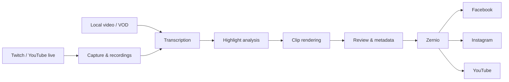

<div align="center">


# StreamSnip AI

**A local-first creator studio for capturing streams, finding standout moments, making short-form clips, and publishing through Zernio.**

[](https://github.com/sifat-jaman-13/stream-clip-ai/releases)
[](https://github.com/sifat-jaman-13/stream-clip-ai)
[](https://github.com/sifat-jaman-13/stream-clip-ai/actions/workflows/tests.yml)
[](LICENSE)
[](https://sifat-jaman-13.github.io/stream-clip-ai/)

[**Download for Windows**](https://github.com/sifat-jaman-13/stream-clip-ai/releases/latest) · [Documentation](https://github.com/sifat-jaman-13/stream-clip-ai#readme) · [Report a bug](https://github.com/sifat-jaman-13/stream-clip-ai/issues)

</div>

---

## Overview

StreamSnip AI turns live streams and recorded video into review-ready short-form clips. It brings capture, creator monitoring, transcription, highlight analysis, video rendering, captions, metadata, and publishing into one desktop-hosted workspace.

The application is **local-first**. Capture, media processing, clip files, and application settings stay on your computer. Hosted AI providers receive transcript text only when you select and configure one. Social publishing is handled by your own Zernio API connection.

### From source to published clip



## What you can do

| Workspace | What it is for |
| --- | --- |
| **Dashboard** | Check engine status, active work, recent clips, and creator activity. |
| **Live Studio** | Configure a live source or local video before starting capture. |
| **Creators** | Monitor saved Twitch and YouTube creators independently and watch recorded-VOD folders. |
| **Clip library** | Preview clips, inspect or edit titles and descriptions, and choose publishing destinations. |
| **Published** | Review clips recorded in the local published registry. |
| **Hype words** | Maintain phrases used by local highlight scoring. |
| **Publishing** | Connect Zernio API keys, discover social accounts, and control posting per account. |
| **Settings** | Configure application-wide storage, appearance, and fonts. |
| **Activity** | Follow capture, processing, and publishing events. |

Opening Live Studio does not start recording. Capture and creator monitoring begin only after an explicit user action.

### Capture and creator monitoring

- Capture supported Twitch and YouTube live streams.
- Process local video files and recorded VODs.
- Keep each creator's live recordings, live clips, VOD inbox, processed originals, and failed VODs in separate folders.
- Run creator monitoring independently from the foreground Live Studio session.
- Configure recording quality and capture behavior from the session setup.

### Transcription and highlight analysis

- Transcribe locally with faster-whisper when the selected Python environment has the speech dependency installed.
- Bring your own command-line transcriber when you prefer another local or hosted transcription tool.
- Score moments with local Hook Words logic.
- Choose Ollama, Gemini, Hugging Face, or a compatible custom chat-completions provider for transcript analysis and post copy.
- Generate transcript-grounded titles, descriptions, and hashtags.

### Clip rendering and review

- Render portrait, landscape, square, and 4:5 layouts.
- Configure captions, framing, subtitle appearance, creator credit, and profanity handling.
- Detect facecam regions across video frames and tune facecam/gameplay crops independently.
- Preview a short render before producing the final clip.
- Edit metadata and review the result before publishing.

Highlight scores are estimates. They are not guarantees of views, reach, or engagement.

## Publishing through Zernio

StreamSnip's supported publishing destinations are **Facebook, Instagram, and YouTube**. Zernio is the publishing provider; StreamSnip does not ask you to configure separate direct-upload API credentials for each social platform.

1. Add the Zernio API key or keys you want to use.
2. Save the connections and let StreamSnip discover the supported social accounts available to each key.
3. Choose which discovered accounts are enabled for posting.
4. Review the clip and its generated copy, then submit it to the selected destinations.
5. Check Activity and Published for the returned publishing results.

**Limits are provider-controlled.** StreamSnip does not impose its own maximum number of Zernio connections, per-platform account slots, or posting quotas. Zernio and the connected social platforms determine account availability and posting limits. API keys in the same Zernio billing workspace share that workspace's request allowance; adding another key does not create a separate quota.

When Zernio reports an account-specific posting cap, StreamSnip can pause that account without disabling other eligible accounts. Workspace-level request throttling is handled separately. A reset is only applied when Zernio supplies reset information; otherwise the account can be re-enabled manually.

A real publish creates an external side effect. Use account discovery and other read-only checks for integration testing; do not run a live publish test unless you intend to create a public or scheduled post.

## AI providers, credentials, and privacy

| Capability | What it needs |
| --- | --- |
| Stream capture | Internet access and the relevant source URL. |
| FFmpeg rendering | FFmpeg installed and available to the application. |
| Built-in transcription | A compatible Python environment and locally available speech model. |
| Custom transcriber | Your own executable or script and its dependencies. |
| Hook Words scoring | Local processing; no hosted AI key. |
| Ollama | A reachable local Ollama service and selected model. |
| Gemini / Hugging Face / custom AI | The selected provider's own endpoint, model, and credential where required. |
| Social publishing | Your Zernio API key and connected social accounts. |

Hosted AI providers receive transcript text when you select them for analysis or copy generation. Use Hook Words or a local Ollama model when you do not want transcript text sent to a hosted AI provider.

Credentials are stored in local application settings and are not returned to the browser interface. The local API uses loopback access and a per-process token for state-changing requests. **Do not expose the application directly to an untrusted LAN or the public internet.** Never commit API keys, OAuth tokens, local settings, recordings, databases, or generated clips.

## Install on Windows

1. Open [GitHub Releases](https://github.com/sifat-jaman-13/stream-clip-ai/releases/latest).
2. Download the latest `StreamSnipAI-Setup.exe` and its SHA-256 checksum file when available.
3. Verify the installer checksum.
4. Run the installer and follow the setup prompts.
5. Launch StreamSnip AI from the installed shortcut.

The installer checks for a compatible 64-bit Python runtime, installs dependencies in an app-managed environment, prepares speech models, and installs FFmpeg when needed. It does not replace a system Python installation or change the global PATH. First-time setup requires an internet connection and can take longer while packages and models are downloaded. Python 3.15 is supported by the installer: it installs faster-whisper without its optional ONNX Runtime VAD dependency, which StreamSnip does not enable. Standard transcription remains available.

The published installer is currently unsigned, so Windows may show a publisher or SmartScreen warning. Review the release and checksum before proceeding.

## Run from source

### Requirements

- Windows 10 or Windows 11 for the primary desktop workflow.
- Python 3.12 recommended for source development (the automated test matrix also covers Python 3.10).
- Node.js 22 and npm for the React dashboard.
- FFmpeg available on `PATH`.
- Internet access for live capture, package installation, and hosted integrations.

### Set up the Python environment

Run from the repository root:

```powershell
git clone https://github.com/sifat-jaman-13/stream-clip-ai.git
cd stream-clip-ai

py -3.12 -m venv .venv
.\.venv\Scripts\Activate.ps1

python -m pip install --upgrade pip
python -m pip install -r requirements.txt
```

### Install and build the dashboard

```powershell
Set-Location .\dashboard
npm ci
npm run lint
npm run build
Set-Location ..
```

### Start StreamSnip AI

From the repository root:

```powershell
python autoclip.py
```

The Python application starts the local engine, serves the production dashboard when `dashboard/dist` is present, and opens the Creator Studio. It prints the selected local address in the terminal.

## Frontend development

Use two PowerShell terminals.

**Terminal 1 — Python engine**

```powershell
$env:STREAMSNIP_PORT = "8204"
.\.venv\Scripts\python.exe .\autoclip.py
```

**Terminal 2 — Vite**

```powershell
Set-Location .\dashboard
npm ci
npm run dev
```

Open [http://127.0.0.1:5173/dashboard/](http://127.0.0.1:5173/dashboard/). Vite proxies `/api` and `/clips` to the Python engine on port 8204. The fixed port keeps the proxy target predictable during development.

The local API documentation is available at [http://127.0.0.1:8204/api/docs](http://127.0.0.1:8204/api/docs) while the development engine is running.

## Tests and quality checks

Install the test runner once, then run the checks from the repository root:

```powershell
python -m pip install "pytest>=8"

# Python syntax
python -m py_compile autoclip.py api_server.py ai_highlights.py post_metadata.py zernio_poster.py facecam_detect.py zernio_connections.py

# Python regression and API/publishing tests
python -m pytest -q
```

From the dashboard folder:

```powershell
npm run lint
npm run build
```

The Windows installer workflow additionally builds the dashboard and packages the installer with Inno Setup. Changes to the optional WinUI 3 shell should also be validated with the .NET Windows project build.

## Architecture

```text
StreamSnip AI
├── autoclip.py                 Python application, workers, legacy service adapter
├── api_server.py               Loopback FastAPI transport and request protection
├── ai_highlights.py            Local and hosted highlight analysis
├── post_metadata.py            Transcript-grounded social copy
├── zernio_poster.py            Zernio API client, upload, and publish outcomes
├── zernio_connections.py       Multi-key connections and per-account selection
├── facecam_detect.py           Facecam detection helpers
├── models/                     Bundled YuNet face-detection model
├── dashboard/                  React + TypeScript + Vite Creator Studio
├── desktop/                    Optional WinUI 3 native Windows shell (in development)
├── installer/                  Windows setup, launcher, and uninstall scripts
├── tests/                      Python regression tests
├── docs/                       Project website
└── assets/                     App branding and images
```

The React dashboard owns presentation and local workspace interactions. The Python application owns capture, creator monitoring, transcription, AI orchestration, rendering, local files, and publishing. FastAPI exposes those established services over localhost; it is not a separate media-processing engine.

## Creator storage layout

Each saved creator has a separate working directory:

```text
Creators/
└── Creator_Name_ID/
    ├── Live/
    │   ├── Recordings/
    │   └── Clips/
    └── Recorded_VODs/
        ├── Watch_Inbox/
        ├── Clips/
        ├── Processed_Originals/
        └── Failed/
```

Enable a creator's recorded-VOD watcher and place a completed recording in its `Watch_Inbox`. StreamSnip waits for the copy to finish before processing it. Removing a creator profile does not automatically delete the files already stored in that creator's folder.

## Troubleshooting

| Problem | What to check |
| --- | --- |
| Engine unavailable | Confirm the Python process is running and check the local address printed at startup. |
| Vite API requests fail | Start the backend with `STREAMSNIP_PORT=8204` and keep the Vite proxy on the same port. |
| Missing video preview | Confirm the clip still exists in the configured output folder and the backend is running. |
| Capture or rendering fails | Check FFmpeg, source availability, free disk space, and the Activity log. |
| AI request fails | Check the selected provider, model, endpoint, API key, and network access. |
| Zernio account is unavailable | Refresh account discovery and check the account's connection and provider status in Publishing. |
| Zernio returns a rate limit | Determine whether the response is account-specific or workspace-wide; other API keys in the same billing workspace share its request allowance. |

For security issues, follow [SECURITY.md](SECURITY.md) and use GitHub's private vulnerability reporting instead of opening a public issue.

## Optional container deployment

The repository includes a multi-stage Docker build that compiles the React dashboard and packages the Python engine. The Windows installer remains the primary desktop distribution; treat the container path as an optional self-hosted deployment.

From the repository root:

```powershell
docker compose up --build
```

Open [http://127.0.0.1:8080](http://127.0.0.1:8080). Docker Compose stores runtime data in the local `./data` directory and binds the published port to localhost. Keep that binding private; do not expose the container directly to an untrusted network. A Docker daemon is required to build and run the image.

## Project links

- [GitHub repository](https://github.com/sifat-jaman-13/stream-clip-ai)
- [Releases and Windows installer](https://github.com/sifat-jaman-13/stream-clip-ai/releases)
- [Issues and bug reports](https://github.com/sifat-jaman-13/stream-clip-ai/issues)
- [Discussions](https://github.com/sifat-jaman-13/stream-clip-ai/discussions)
- [Project website](https://sifat-jaman-13.github.io/stream-clip-ai/)

## Licence

StreamSnip AI is released under a **Proprietary Non-Commercial Use Licence**. It is source-available, not open source. The licence permits personal, private, and individual educational use under its terms. Commercial use, paid services, organisational use, and public redistribution require prior written permission from the applicable copyright holder(s). Read [LICENSE](LICENSE) before using the software.

Third-party notices for bundled components are provided in [LICENSE-NeonClipping.txt](LICENSE-NeonClipping.txt) and [LICENSE-YuNet.txt](LICENSE-YuNet.txt). Their separate licence terms remain in effect.

<div align="center">

**Find the moment. Make it a clip.**

Built by [Sifat Jaman / ScarZero](https://github.com/sifat-jaman-13).

</div>
