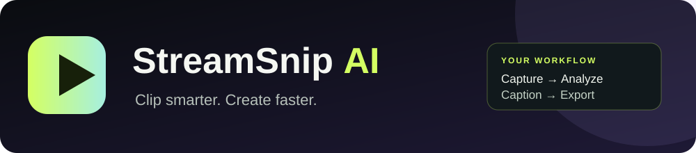
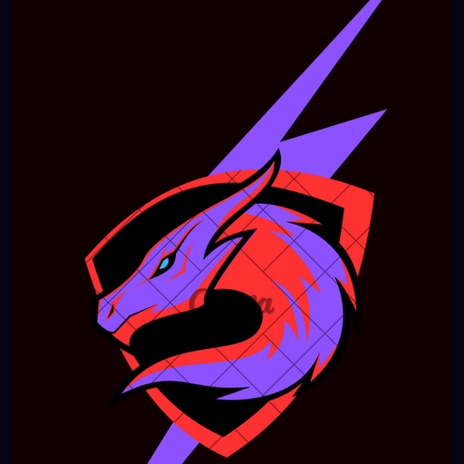

<p align="center">
  
</p>
<p align="center">
  
</p>
<p align="center">
  
</p>
<p align="center"><a href="assets/streamsnipai-social-card.svg">Open the 1200 × 630 social/share card</a></p>

<h1 align="center">StreamSnip AI</h1>
<p align="center"><strong>Current Windows build: v2.1.3</strong></p>

<p align="center"><a href="https://sifat-jaman-13.github.io/stream-clip-ai/"><strong>Visit the StreamSnip AI website</strong></a></p>

> First-time website setup: open **Settings → Pages** and set **Build and deployment → Source** to **GitHub Actions**. The workflow in `.github/workflows/deploy-site.yml` will then publish the site.

<p align="center">
  A local-first stream clipper for turning Twitch, YouTube, and video files into captioned clips for Shorts, Reels, TikTok, and YouTube.
</p>

<p align="center">
  <a href="https://github.com/sifat-jaman-13/stream-clip-ai/releases/latest"></a>
  <a href="https://github.com/sifat-jaman-13/stream-clip-ai/releases/latest/download/StreamSnipAI-Setup.exe"></a>
  <a href="https://github.com/sifat-jaman-13/stream-clip-ai/actions/workflows/tests.yml"></a>
  <a href="LICENSE"></a>
  
</p>

StreamSnip AI records supported live streams or reads local video files, transcribes speech with faster-whisper, finds promising moments, and renders share-ready clips with FFmpeg. The default hook-word workflow runs locally and requires no cloud API key. Ollama provides optional local AI analysis; Gemini and Hugging Face are optional hosted providers.

> [!IMPORTANT]
> StreamSnip AI is local-first, not fully offline. Live-stream capture, first-time dependency/model downloads, hosted AI providers, update checks, and Zernio publishing require internet access.

## At a glance

| Area | Support |
|---|---|
| Sources | Twitch live, YouTube live, and FFmpeg-supported local video/VOD files |
| Transcription | Local faster-whisper models with word timestamps |
| Highlight detection | Hook words, Ollama, Gemini, or Hugging Face |
| Rendering | FFmpeg with automatic CUDA/NVENC use when supported |
| Formats | 9:16, 16:9, 1:1, and 4:5 |
| Captions | Karaoke/classic modes, presets, colors, fonts, position, and size controls |
| Publishing | Manual or optional automatic publishing through Zernio |
| Deployment | Windows installer, Python source, headless CLI, or Docker Compose |

## How it works

1. **Capture or import** a Twitch/YouTube stream or local video.
2. **Transcribe locally** with faster-whisper.
3. **Score moments** with hook words or a selected AI provider.
4. **Select bounded clips** around the strongest non-overlapping moments.
5. **Render locally** with captions, layout, creator credit.
6. **Review and publish** from the local gallery or send selected clips to Zernio.

Recordings, settings, transcription, rendering, and generated clips remain on the machine unless a hosted AI or publishing feature is explicitly used.

## Absolute requirements before installing (Windows)

> Check these requirements **before** running the Windows installer. The installer can prepare Python and FFmpeg automatically, but it still needs internet access and WinGet when those tools are missing.

### Required for the Windows installer

- **Operating system:** Windows 10 or Windows 11, 64-bit (x64).
- **Internet connection:** required for first-time Python packages, FFmpeg if missing, and the Whisper speech-model downloads.
- **Python:** 64-bit Python **3.10, 3.11, or 3.12**. The installer accepts these versions and installs Python 3.12 with WinGet when none is found.
- **FFmpeg:** required for video/audio processing. The installer installs it with WinGet if it is not already available.
- **WinGet / App Installer:** required only when the installer needs to download Python or FFmpeg automatically. If WinGet is unavailable, install the missing prerequisite manually from the links below.
- **Free disk space:** leave room for the isolated Python environment, packages, downloaded Whisper models, recordings, and rendered clips. Model and output sizes depend on your selected workflow.
- **GPU:** an NVIDIA GPU is optional. CPU processing is supported; compatible CUDA/NVENC hardware can accelerate supported stages.

### Official downloads

| Requirement | Download |
|---|---|
| Python for Windows (64-bit) | [python.org — Windows downloads](https://www.python.org/downloads/windows/) |
| FFmpeg | [FFmpeg download page](https://ffmpeg.org/download.html) |
| WinGet / App Installer | [Microsoft Store — App Installer](https://apps.microsoft.com/detail/9NBLGGH4NNS1) |
| Git (source checkout only) | [git-scm.com — Windows](https://git-scm.com/download/win) |

### PowerShell: install missing prerequisites with WinGet

Open PowerShell and run only the commands for tools you do not already have. Python 3.12 and FFmpeg are the same package IDs used by the Windows setup script.

```powershell
winget --version

# Install Python 3.12 (skip if Python 3.10–3.12 x64 is already installed)
winget install --id Python.Python.3.12 --exact --source winget --scope user --accept-package-agreements --accept-source-agreements

# Install FFmpeg (skip if ffmpeg.exe is already available on PATH)
winget install --id Gyan.FFmpeg --exact --source winget --accept-package-agreements --accept-source-agreements

# Verify the tools (py -0p lists installed Python versions)
py -0p
ffmpeg -version
```

If `winget` is not recognized, install or update **App Installer** from the Microsoft Store link above, reopen PowerShell, and check `winget --version` again. You can also install Python and FFmpeg manually from their official download pages. Git is only needed when cloning the source repository; it is not required for the Windows installer.

## Install on Windows

Download **`StreamSnipAI-Setup.exe`** from the [latest release](https://github.com/sifat-jaman-13/stream-clip-ai/releases/latest) or use the [direct installer link](https://github.com/sifat-jaman-13/stream-clip-ai/releases/latest/download/StreamSnipAI-Setup.exe).

The release also includes **`StreamSnipAI-Setup.exe.sha256`** so the installer can be verified:

```powershell
Get-FileHash .\StreamSnipAI-Setup.exe -Algorithm SHA256
Get-Content .\StreamSnipAI-Setup.exe.sha256
```

The installer is currently unsigned, so Windows SmartScreen may display a warning. Download installers only from this repository's official Releases page.

### What first-time setup does

The lightweight installer:

1. detects 64-bit Python 3.10, 3.11, or 3.12;
2. installs Python 3.12 with WinGet if no supported Python is available;
3. creates an isolated runtime inside the StreamSnip AI installation folder;
4. installs the pinned/runtime dependencies from `requirements.txt`;
5. installs FFmpeg with WinGet when FFmpeg is missing;
6. launches the local app and writes setup diagnostics to `%LOCALAPPDATA%\StreamSnip AI\setup.log`.

Later launches reuse the isolated runtime. Reinstalling a newer version over the existing installation preserves local settings and updates the packaged source files.

**Important - safe shutdown (v2.1.3):** StreamSnip AI prints an explicit startup warning in its support terminal. Keep that terminal window **OPEN** while the app is running. To exit, click **Quit** inside StreamSnip AI and wait until the app has fully shut down before closing the terminal. Closing the terminal directly may interrupt active recording, clip processing, or uploads.

Hugging Face authentication is optional and requested only once during setup. Paste a token to enable authenticated model downloads, or press **Enter** to skip; unauthenticated public downloads may be slower. The choice is remembered, and a token can be added later in **AI settings > Hugging Face**.

Uninstalling removes the isolated Python runtime, pip-installed packages, and downloaded Whisper models. It also removes Python 3.12 or FFmpeg only when the StreamSnip AI setup recorded that it installed that global package. Existing clips, recordings, and local settings are preserved.

## Quick start

1. Open StreamSnip AI.
2. Choose **Live stream** or **Video file / VOD**.
3. Paste a supported URL or browse to a local video.
4. Choose a highlight engine. **Hook words** is the offline default.
5. Configure clip score, duration, captions, format, layout, credit.
6. Select **Start clipping**.
7. Review finished clips in the gallery, copy captions, download files, reveal them in Explorer, or publish selected clips.

Use **Stop & finish clips** to finish already captured live content and **Stop now** for an immediate stop. To exit StreamSnip AI, click **Quit** inside the app and wait for shutdown to complete before closing the support terminal. Keep the terminal open while the app is running; closing it directly may interrupt active recording, clip processing, or uploads.

## Highlight engines

| Engine | Runs where | Credential | Behavior |
|---|---|---|---|
| Hook words | Local | None | Default scoring using built-in and user-defined words/phrases |
| Ollama | Local | None | Uses a model already installed in the local Ollama service |
| Gemini | Google-hosted | Gemini API key | Sends transcript windows to Gemini; hosted quota and limits apply |
| Hugging Face | Hosted inference providers | Hugging Face token | Sends transcript windows to the selected hosted model; provider credits may apply |

Whisper transcription is separate from highlight analysis and stays local. The **Test connection** button makes a minimal authenticated inference request without returning stored credentials to the browser.

Create or revoke Hugging Face tokens at <https://huggingface.co/settings/tokens>. Use the minimum permissions needed for Inference Providers/model downloads, then save the replacement token in the AI card and run **Test connection**.

Gemini currently prefers `gemini-3.8-flash`. On retryable model/API failures, StreamSnip AI discovers every usable Gemini text model exposed by the key and tries each model three times before falling back to local Ollama. This resilience can make many hosted requests and consume quota when a provider is degraded.

## Captions, layouts, and output

- Output ratios: **9:16**, **16:9**, **1:1**, and **4:5**.
- Portrait layouts: facecam + gameplay, blurred background, center fill, or a selected crop.
- Captions: karaoke or classic timing with Classic, Hormozi, Neon, MrBeast, Minimal, and Fire presets.
- Customization: highlight color, font, words per line, font size, vertical position, text/stroke colors, and alignment.
- Branding: automatic streamer credit and optional custom credit.
- Output: each MP4 clip has a matching TXT file. The **first non-empty line is the title** and everything below it is the description.
- **Automatic AI titles and descriptions (v2.1.3):** every finished clip is written with a title and description automatically. When Gemini, local Ollama, or Hugging Face is selected for highlight detection, that same provider generates the post copy (there is no separate copy-provider setting). All three providers receive the same creator-style instructions: catchy Title Case titles with fitting emojis, a short exact quote when the transcript contains a memorable line, a natural follow-up explaining the moment, and a concise topic hashtag. The TXT writer adds creator attribution when available plus the standard tags #shorts #fyp #streamer #clips #viral and one context-specific tag such as #funny. Titles are capped at 100 characters. Copy must stay grounded in the transcript and cannot invent dialogue, people, games, locations, visuals, or outcomes.
- Quote-only or otherwise unusable AI descriptions are rejected. If Hook words is selected, or the selected provider returns an error/unusable response, the clip still renders and receives transcript-based fallback copy. Gemini/Hugging Face use hosted quota/credits; local Ollama uses your locally installed model and its available hardware.
- The per-clip TXT contains post-ready title, description, creator credit (when available), and hashtags. Filenames and source timestamps stay in the cumulative `clips_metadata.txt` index instead of being accidentally included in the public post description.
- A cumulative `clips_metadata.txt` index in the output folder lists metadata and source timestamps for every generated clip.

## Zernio publishing

Zernio is the supported posting integration.

1. Create a Zernio API key and connect the intended Instagram/YouTube accounts in Zernio.
2. Open **Settings** in StreamSnip AI.
3. Under **Publishing provider**, enter the API key.
4. Select **Save & identify channels**.
5. Choose the connected Instagram and/or YouTube account.
6. Set scheduling delay, YouTube visibility, and optional auto-post behavior.

Auto-post is disabled by default. Manual publishing is available for one clip, selected clips, or all clips. Zernio API access, account permissions, platform policies, quotas, and service limits apply.

## Data, credentials, and privacy

| Deployment | Default data location |
|---|---|
| Windows installer | The installed app's `source` folder, with user-selected recording/output folders supported |
| Source checkout | The repository folder unless `STREAMSNIP_DATA_DIR` is set |
| Docker Compose | `./data` on the host, mounted as `/data` in the container |

Local runtime files include:

- `settings.json` — clipping and rendering settings;
- `ai_settings.json` — AI provider selection and saved hosted credentials;
- `publishing.json` / `zernio.json` — publishing credentials and account selections;
- `custom_words.txt` — custom hook words and weights;
- `rec/` and `out/` — recordings and generated clips unless custom folders are selected.

These paths are ignored by Git. Never commit, attach, or publicly share them. Rotate a credential immediately if it appears in logs, screenshots, exported sessions, or support diagnostics.

Use **Clear saved key** / **Clear saved token** in the AI card to remove hosted AI credentials from the current installation before replacing or retiring them.

Network behavior:

- Twitch/YouTube URLs are accessed by Streamlink during live capture.
- Speech models and packages are downloaded on first use/setup.
- Gemini/Hugging Face receive transcript text only when selected.
- Zernio receives selected video/caption data only when publishing is requested or auto-post is enabled.
- GitHub and PyPI are contacted by explicit update checks.

The web UI binds to loopback by default and uses a per-process token for state-changing requests. Docker Compose publishes port 8080 to `127.0.0.1` only.

## Run from source

### Requirements

- Python 3.10 or newer (Python 3.12 is the recommended/tested Windows runtime)
- FFmpeg available on `PATH`
- Internet access for initial package and speech-model downloads
- Optional: NVIDIA CUDA support for faster transcription/rendering
- Optional: Ollama for local LLM-based highlight selection

### PowerShell

```powershell
git clone https://github.com/sifat-jaman-13/stream-clip-ai.git
cd stream-clip-ai

py -3.12 -m venv .venv
.\.venv\Scripts\Activate.ps1
python -m pip install --upgrade pip
python -m pip install -r requirements.txt
python autoclip.py
```

The desktop-style web window opens automatically. Source mode chooses an available loopback port by default and prints the exact URL in the terminal. To request a fixed port:

```powershell
$env:STREAMSNIP_PORT = "8080"
python autoclip.py
```

### Headless CLI

```bash
python autoclip.py live https://www.twitch.tv/your_channel
python autoclip.py live https://www.youtube.com/@your_channel
python autoclip.py file /path/to/recording.mp4
```

Installing the project with `pip install -e .` also provides the `autoclip` and `streamclip` commands. Install the `live` extra for Streamlink or `all` for Streamlink plus the Windows CUDA runtime:

```bash
python -m pip install -e ".[live]"
```

## Environment variables

| Variable | Purpose |
|---|---|
| `STREAMSNIP_DATA_DIR` | Override the runtime settings/recording/output root |
| `STREAMSNIP_BIND_HOST` | HTTP bind address; defaults to `127.0.0.1` |
| `STREAMSNIP_PORT` | HTTP port; defaults to an available port in desktop/source mode |
| `STREAMSNIP_OLLAMA_URL` | Ollama endpoint; local addresses only |
| `HF_TOKEN` / `HUGGING_FACE_HUB_TOKEN` | Optional Hugging Face credential and authenticated model downloads |
| `ZERNIO_API_KEY` | Optional Zernio API key |
| `ZERNIO_INSTAGRAM_ACCOUNT_ID` | Optional default Instagram account ID |
| `ZERNIO_YOUTUBE_ACCOUNT_ID` | Optional default YouTube account ID |
| `ZERNIO_ENABLED` | Enable environment-configured automatic publishing |
| `ZERNIO_SCHEDULE_MINUTES` | Default publishing delay |
| `ZERNIO_YOUTUBE_VISIBILITY` | `public`, `unlisted`, or `private` |

## Docker

Docker Compose builds the app and exposes it only on the local machine:

```bash
docker compose up --build
```

Open <http://127.0.0.1:8080>. Runtime data is stored in `./data`. The compose file routes Ollama requests to `host.docker.internal:11434`.

Because the service uses `restart: unless-stopped`, use the following command when you intend to stop the Docker deployment completely:

```bash
docker compose down
```

## Development and validation

Run the regression suite and syntax checks before submitting a change:

```bash
python -m unittest discover -s tests -v
python -m py_compile autoclip.py ai_highlights.py zernio_poster.py
```

GitHub Actions runs the regression suite on Windows and Linux with supported Python versions.

### Build the Windows installer

Windows packaging requires the .NET Framework C# compiler and Inno Setup 6:

```powershell
powershell -NoProfile -ExecutionPolicy Bypass -File .\build_windows.ps1
```

Build output:

- `dist\StreamSnipAI\StreamSnipAI.exe` — lightweight launcher;
- `dist\installer\StreamSnipAI-Setup.exe` — Inno Setup installer.

`AutoClip.spec` is retained as a legacy full PyInstaller bundle configuration; the current release installer uses the lightweight launcher and target-PC runtime setup.

## Repository map

| Path | Purpose |
|---|---|
| `autoclip.py` | Local server/UI, settings, capture, transcription, scoring, rendering, gallery, and orchestration |
| `ai_highlights.py` | Ollama, Gemini, and Hugging Face analysis and provider checks |
| `zernio_poster.py` | Zernio account discovery, upload, scheduling, and publishing |
| `assets/` | Application icon and brand artwork |
| `installer/` | Windows launcher, setup bootstrap, and Inno Setup definition |
| `build_windows.ps1` | Windows launcher/installer build script |
| `Dockerfile`, `docker-compose.yml` | Local Docker deployment |
| `tests/test_regressions.py` | Regression coverage for clipping, AI, rendering, security, publishing, and shutdown |
| `.github/workflows/` | Tests and release-asset maintenance automation |

## Troubleshooting

- **Windows SmartScreen warning:** the installer is not code-signed. Verify its SHA-256 file and use only the official release.
- **First launch takes time:** Python packages, FFmpeg, and the selected Whisper model may need downloading.
- **Installer problem:** inspect `%LOCALAPPDATA%\StreamSnip AI\setup.log`.
- **Buttons do not respond:** disable ad blocking for `127.0.0.1` / `localhost`.
- **Gemini/Hugging Face failure:** use **Test connection** and verify the account has API access/quota or provider credits.
- **Zernio DNS error:** check internet, VPN, firewall, and DNS settings; the app retries transient DNS failures automatically.
- **Safe shutdown:** click **Quit** inside StreamSnip AI and wait until it has shut down before closing the support terminal. Do not close the terminal directly while recording, clip processing, or uploads may be active.

## Project

Created and maintained by **Sifat Jaman / ScarZero**.

- [GitHub repository](https://github.com/sifat-jaman-13/stream-clip-ai)
- [Latest release](https://github.com/sifat-jaman-13/stream-clip-ai/releases/latest)
- [YouTube — Scar Clip Farm](https://youtube.com/@scarclipfarm)
- [YouTube — Scarzero](https://www.youtube.com/@scarzeroyt)
- [Instagram — @scarzero13](https://www.instagram.com/scarzero13/)
- [Facebook — ScarZero13](https://www.facebook.com/ScarZero13)
- [Twitch — scarzero13](https://www.twitch.tv/scarzero13)
- [TikTok — @scarzero13](https://www.tiktok.com/@scarzero13)

Development has included assistance from OpenAI, Anthropic, and Google AI tools. Project direction, release decisions, and repository ownership remain with Sifat Jaman.

See [CONTRIBUTING.md](CONTRIBUTING.md) before proposing a change and [SECURITY.md](SECURITY.md) for private vulnerability reporting guidance.

## License

StreamSnip AI is available under the [MIT License](LICENSE).
