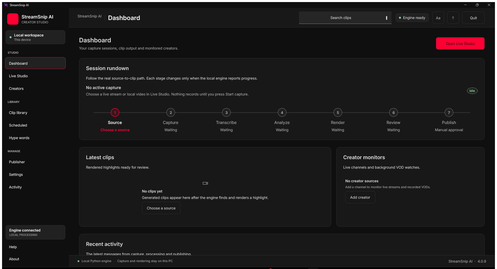
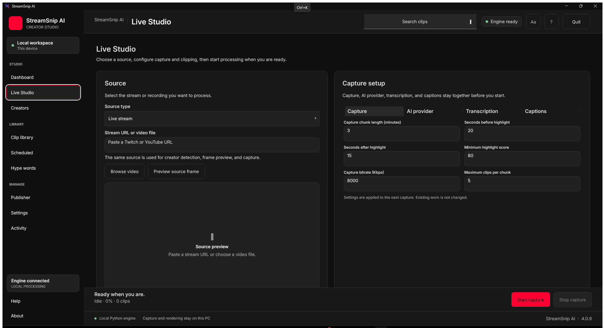
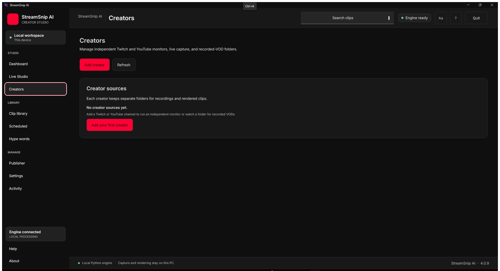
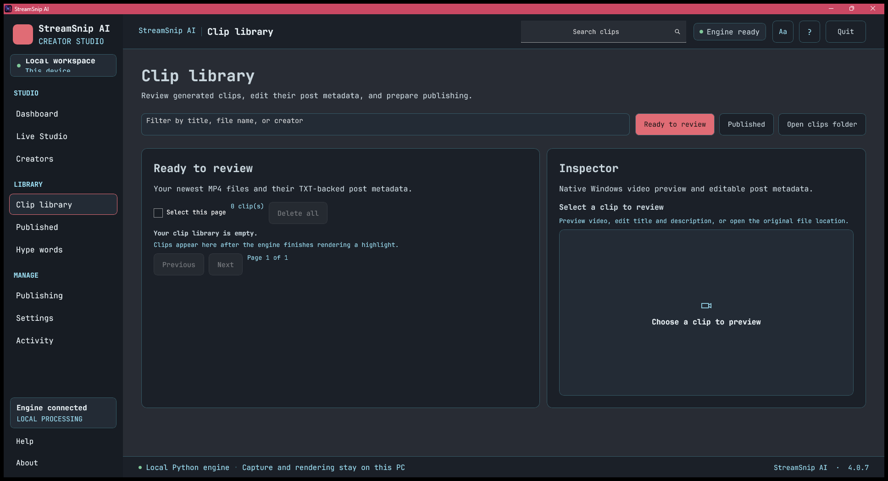
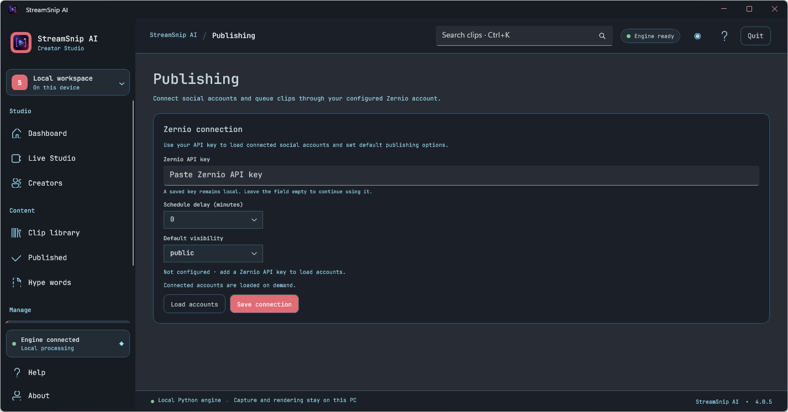

# StreamSnip AI User Guide

This guide covers installation, first capture, creator monitoring, clip review, publishing, settings, storage, and troubleshooting.

## What StreamSnip AI does

StreamSnip AI is a **native Windows creator studio** for turning supported Twitch and YouTube live streams, recorded VODs, and local videos into short-form clips. It connects capture, creator monitoring, local transcription, AI-assisted highlight selection, facecam-aware framing, animated captions, clip review, post metadata, and controlled publishing.

The installed desktop app is **WinUI 3**. A supervised local Python engine performs media work with Streamlink, FFmpeg, Faster-Whisper, OpenCV/YuNet, and the AI provider you configure. The React/Vite dashboard in `dashboard/` is a separate browser-oriented frontend; it is not the installed WinUI shell.

**Important:** opening Live Studio does not start recording. You choose a source, configure the session, and press **Start capture** yourself. StreamSnip does not automatically publish clips.

## Screenshots

Screenshots below are from the **4.0.7 native Windows Release build**.

<p align="center">
  
</p>

<details>
  <summary><strong>View the other workspaces</strong></summary>
  <br>
  <table>
    <tr>
      <td width="50%">
        <p align="center"><strong>Live Studio</strong></p>
        
      </td>
      <td width="50%">
        <p align="center"><strong>Creator monitoring</strong></p>
        
      </td>
    </tr>
    <tr>
      <td width="50%">
        <p align="center"><strong>Clip Library</strong></p>
        
      </td>
      <td width="50%">
        <p align="center"><strong>Publishing</strong></p>
        
      </td>
    </tr>
  </table>
</details>

## Install StreamSnip AI

### Requirements

- Windows 10 or Windows 11, 64-bit.
- Internet access during setup if the installer needs to download or repair runtime packages, FFmpeg components, or speech-model files.
- Free disk space for recordings, source videos, generated clips, and downloaded transcription models. Video files and AI models can be large.

You do **not** need to install Python or FFmpeg globally before using the packaged app. The installer prepares an isolated application runtime and does not replace system Python or change the global `PATH`.

### Download and verify

1. Open [the latest GitHub release](https://github.com/sifat-jaman-13/stream-clip-ai/releases/latest).
2. Download `StreamSnipAI-Native-Setup.exe` and its matching `.sha256` file into the same folder.
3. Open PowerShell in that folder and run:

```powershell
$installer = '.\StreamSnipAI-Native-Setup.exe'
$checksum = "$installer.sha256"
$expected = ((Get-Content -LiteralPath $checksum -Raw).Trim() -split '\s+')[0].ToLowerInvariant()
$actual = (Get-FileHash -LiteralPath $installer -Algorithm SHA256).Hash.ToLowerInvariant()

if ($actual -ne $expected) {
    throw 'SHA-256 mismatch. Do not run this installer.'
}

Write-Host "SHA-256 verified: $actual"
```

4. Run the installer and follow the setup prompts.
5. Launch StreamSnip AI from the Start menu or desktop shortcut.

The installer is currently unsigned, so Windows SmartScreen may show a publisher warning. Only continue if you downloaded the installer from this project's official GitHub release and the SHA-256 verification succeeded.

### What setup does

Setup prepares the native desktop app and its isolated local engine. It checks for compatible runtime components and required packages, reuses compatible components, and installs or repairs missing items. Speech-model downloads may be deferred until you first select or use a model. Setup diagnostics are written to:

```
%LOCALAPPDATA%\StreamSnip AI\setup.log
```

A Hugging Face token is optional. It may help with gated or rate-limited model downloads, but it is not an AI highlight-provider key.

## First launch: make your first clip

This is the recommended first-time workflow. Each step is performed in the native Windows app.

### 1. Check the Dashboard

Open **Dashboard** and confirm the local engine is connected and ready. The dashboard shows the current session, processing stage, recent clips, creator activity, and recent engine events.

If the engine is offline, use the runtime repair option in the app or rerun the latest installer and choose Repair. Do not start a capture while the engine is unavailable.

### 2. Choose a source in Live Studio

Open **Live Studio**.

- Set **Source type** to **Live stream** for a Twitch or YouTube stream.
- Set **Source type** to **Video file / VOD** for a local video.
- Paste the stream URL, or use **Browse video** to select a local file.
- Use **Preview source frame** to verify that the URL or file can be read and that the correct video is selected.

The preview is a still frame check; it does not start capture. Supported local video extensions in the file picker include MP4, MKV, MOV, WEBM, AVI, and TS.

### 3. Configure Capture

In Live Studio, open the **Capture** tab. These settings apply to the next capture; they do not change clips already rendered.

| Setting | What it controls |
| --- | --- |
| Capture chunk length | Length of each recording segment, in minutes |
| Seconds before highlight | Source footage retained before a detected moment |
| Seconds after highlight | Source footage retained after a detected moment |
| Minimum highlight score | Threshold used to filter candidate moments |
| Capture bitrate | Recording bitrate in Kbps; higher values use more disk space |
| Maximum clips per chunk | Limit on clips generated from each chunk |

The current UI accepts chunk lengths of 3-60 minutes, pre/post highlight windows of 3-90 seconds, highlight scores of 0-100, capture bitrates of 8,000-50,000 Kbps, and 1-50 clips per chunk. These are bounds, not recommended values for every source. Start with the defaults and adjust after reviewing results.

### 4. Configure the AI provider

Open **AI provider** in Live Studio. One selected provider analyzes transcript windows, chooses candidate highlights, and generates the clip title, description, and topical tags.

| Provider | Setup |
| --- | --- |
| Google Gemini | Enter the model ID and Google AI Studio API key |
| Ollama | Enter the local Ollama server URL (default `http://127.0.0.1:11434`) and an installed model name |
| OpenAI / ChatGPT API | Enter API base URL, model ID, and API key |
| Anthropic / Claude API | Enter API base URL, Claude model ID, and API key |
| Custom OpenAI-compatible API | Enter the compatible base URL and model; a key may be left blank for a local endpoint |

For hosted providers, create an API key with the provider and make sure your account has access to the selected model and available quota. API billing and limits are set by the provider, not StreamSnip AI.

Use **Test provider** to check the current configuration, then **Save AI settings**. Credentials are entered into password fields; leave the key field empty when keeping an already saved key. Ollama runs locally and does not require a hosted AI key, but the Ollama service and selected model must be installed and running.

### 5. Configure Transcription

Open **Transcription** in Live Studio.

- Choose a Faster-Whisper model. Larger models can improve recognition but usually require more RAM, VRAM, and processing time.
- Set the transcription language, or leave it as `auto` to detect the spoken language.
- Choose CPU threads for CPU transcription. Compatible NVIDIA GPU acceleration may be used when available.

Faster-Whisper transcription and media processing run locally. The first run may download model files, so allow time and disk space.

### 6. Configure Captions and framing

Open **Captions** in Live Studio.

| Setting | Purpose |
| --- | --- |
| Video layout | Choose a supported layout such as facecam + gameplay, full video, or selected crop |
| Output format | Choose 9:16 portrait, 16:9 landscape, 1:1 square, or 4:5 |
| Subtitle mode | Karaoke or Classic |
| Subtitle style | GTA Neon, Classic, Hormozi, Neon, MrBeast, Minimal, or Fire |
| Creator credit | Set a manual handle or leave it blank to infer one from supported Twitch/YouTube URLs |
| Show creator tag | Toggle the creator tag in the rendered video |
| Filter detected profanity | Enable or disable the profanity filter |

Facecam framing uses **local multi-frame facecam detection** with OpenCV and YuNet. It can assist with framing but is not guaranteed to identify every face or choose the ideal crop for every scene. Review the final clip.

### 7. Start and stop capture

After selecting the source and saving your settings:

1. Press **Start capture** in Live Studio.
2. Watch the real engine status and progress in Live Studio or Dashboard.
3. The engine records or processes the source, transcribes speech, analyzes candidate moments, and renders clips as the workflow progresses.
4. Press **Stop capture** when you are finished.

A graceful stop requests that active work finish safely. Do not force-close the app while it is writing a recording or rendering a clip. For a live source that is offline, the capture engine may wait and reconnect when the stream becomes available.

### 8. Review the output

Open **Clip Library** and select a rendered clip.

- Preview the MP4 and check the crop, captions, and timing.
- Review the generated title, description, and tags.
- Correct metadata before publishing.
- Use the clip's file or folder actions to locate the saved media.

Each generated clip has an MP4 and a matching TXT metadata sidecar. AI-selected moments are suggestions; they are not a promise of views, engagement, or virality.

## Creator monitoring

Use **Creators** when you want to keep multiple channels organized independently of the current Live Studio source.

1. Select **Add creator**.
2. Enter a creator name and a Twitch or YouTube channel URL.
3. Confirm the detected handle/name and save the profile.
4. Use **Start monitor** to monitor the channel.
5. Use **Watch VOD folder** to watch that creator's recorded-VOD folder.
6. Use **Open folders** to find that creator's recordings and rendered clips.

Creator monitoring, VOD folder watching, and Live Studio capture are separate controls. Starting a creator monitor does not start the current Live Studio capture. Removing a creator profile removes the monitor profile only; existing recordings and clips are kept.

## Clip Library and Published

**Clip Library** is for generated clips that are still being reviewed. Use the list filters and clip inspector to find a clip, preview it, and review its metadata.

**Published** is a separate registry for confirmed publishing results. A destination is marked published only after the integration confirms success. Failed or pending posts should not be treated as published.

Keep the source recording until you have reviewed and backed up the clips you need.

## Publishing through Zernio

Publishing is optional and requires your own Zernio connection and supported social account access.

1. Open **Publishing**.
2. Connect or configure your Zernio integration.
3. Refresh/discover the accounts returned by Zernio.
4. Enable posting for the accounts you want to use.
5. When preparing a post, choose the intended connected destination and review the video and post details.
6. Submit the post and check the destination result in the app and Activity.

The current Zernio integration supports **Facebook, Instagram, and YouTube**. **TikTok is not a supported destination in the current Zernio integration.** Account availability, upload limits, API quotas, and posting errors are controlled by Zernio and the connected platforms. Multiple API keys may still belong to the same Zernio workspace and share its usage allowance.

StreamSnip AI records a destination as published only after confirmed success. Review every clip, title, description, and destination before submitting.

## Other workspaces

| Workspace | What it is for |
| --- | --- |
| Dashboard | Session state, processing rundown, recent clips, creator activity, and engine events |
| Live Studio | Source, capture, AI provider, transcription, and caption setup |
| Creators | Independent channel monitors and recorded-VOD folder watching |
| Clip Library | Find, preview, and review rendered clips and metadata |
| Published | Confirmed publishing records |
| Hype words | Manage local highlight phrases used by the Hook Words scoring option |
| Publishing | Zernio connection, account discovery, and destination controls |
| Settings | Application-wide appearance and storage options |
| Activity | Engine and workflow event history |
| Help & how-to | In-app quick start and troubleshooting |
| About | App version, architecture, source, and release links |

## Appearance and settings

The native app includes curated themes, including Odysseus, Studio Light, Studio Dark, GitHub Dark, Nord, Odysseus Paper, Ocean Depths, Forest Night, Solarized Paper, Rose Graphite, Ember Studio, and Slate Studio.

Use the topbar appearance selector or **Settings > Appearance** to choose a theme. Where available, you can set a custom six-digit hex accent and reset it to the active theme's default. The accent changes primary actions and current selections; semantic success, warning, and error colors remain distinct.

Settings are saved locally. AI credentials are managed separately in Live Studio's AI provider tab and require the explicit **Save AI settings** action.

## Files, storage, and privacy

The installed app stores its local engine data under:

```
%LOCALAPPDATA%\StreamSnip AI\
```

Common data includes:

| Location | Contents |
| --- | --- |
| `out\` | Generated clips and output files |
| `rec\` | Source recordings and capture chunks |
| `models\` | Downloaded speech and model assets |
| `settings.json` | General engine settings |
| `ai_settings.json` | AI provider configuration |
| `custom_words.txt` | Local Hook Words phrases |
| `zernio.json` / `publishing.json` | Publishing connection and account configuration |
| `streamsnip.log` | Local engine diagnostic log |

Creator profiles also have separate folders for their recordings and rendered clips. Use **Open folders** from a creator profile to find them.

### Where processing happens

| Task | Where the data goes |
| --- | --- |
| Capture, source recordings, local video, FFmpeg rendering, Faster-Whisper, OpenCV/YuNet, and Hook Words | Your Windows PC |
| Local language-model analysis | Your configured Ollama service |
| Hosted AI analysis | Transcript text is sent to the provider you selected for that task |
| Social publishing | Selected media and post details are sent to Zernio and the destination platform you choose |

You can use local capture, transcription, rendering, Hook Words, and Ollama without a hosted AI API key. Hosted AI services receive transcript text when you choose and invoke them; check their privacy, retention, and billing terms before connecting.

The local FastAPI engine binds to loopback and uses a per-process session token for state-changing requests. **Do not expose the engine API to an untrusted network or the public internet.** Never commit API keys, social tokens, cookies, source URLs containing private access tokens, or local browser profiles.

## Troubleshooting

### The app says the local engine is offline

- Wait for the initial startup check to finish.
- Use the runtime repair option if it is available.
- Otherwise rerun the latest official installer and choose Repair.
- Check `%LOCALAPPDATA%\StreamSnip AI\setup.log` and `streamsnip.log` for the failure details.

### Source preview does not show a frame

- Confirm the URL is a supported Twitch or YouTube stream/VOD URL.
- Check that the stream is online and accessible in your region/account.
- For a local file, confirm the file exists and can be opened by a media player.
- Try the preview again after a few seconds. A preview frame does not mean capture has started.

### Capture starts but no clips appear

- Confirm the source contains audio/speech that can be transcribed.
- Check that the AI provider test succeeds and that the selected model is available.
- Lower the minimum highlight score if it is too restrictive.
- Increase the maximum clips per chunk if you intentionally want more candidates.
- Allow transcription, analysis, and rendering to finish; longer VODs can take time.
- Check Activity and the engine log for the actual stage or error.

### Transcription is slow or runs out of memory

- Select a smaller Faster-Whisper model.
- Reduce CPU threads if the system becomes unresponsive.
- Ensure the model has finished downloading.
- Use a compatible NVIDIA GPU when available, or allow CPU processing to complete.
- Keep enough disk space for model files and temporary media.

### AI provider test or analysis fails

- Recheck the provider, model ID, API base URL, and key.
- Confirm the account has model access and remaining quota.
- For Ollama, verify that the local service is running and the model is installed.
- Use **Test provider** before starting another capture.

### Publishing fails

- Refresh the Zernio account list and confirm the target account is enabled.
- Check the destination platform's connection, media requirements, and quota.
- Review the per-destination result and Activity log.
- Do not retry repeatedly if the provider reports a rate limit or a post is still processing.

### A clip is missing or cannot be opened

- Check the output folder and available disk space.
- Wait for the current render to finish before closing the app.
- Check the clip's TXT sidecar and engine log for the source and render details.
- Back up the `out\` and `rec\` folders before moving or deleting files.

## Update, repair, backup, and uninstall

- **Update:** Download the newest installer from [GitHub Releases](https://github.com/sifat-jaman-13/stream-clip-ai/releases/latest) and run it over the existing installation.
- **Repair:** Rerun the latest installer if the native app or isolated runtime is missing or damaged.
- **Backup:** Before reinstalling, moving data, or uninstalling, copy `%LOCALAPPDATA%\StreamSnip AI\` and any creator-specific folders you want to keep. This includes settings, model files, recordings, and clips.
- **Uninstall:** Use Windows Installed apps or the app's uninstaller. Read the uninstaller's config-retention prompt carefully and keep a separate backup of recordings and clips.

Do not delete `out\`, `rec\`, or creator folders until you have verified that you no longer need their contents.

## Build from source

### Developer prerequisites

- Windows 10/11 x64
- Python 3.10 or newer
- Node.js 22 with npm
- .NET 10 SDK
- Inno Setup 6
- FFmpeg

### Development setup

```powershell
git clone https://github.com/sifat-jaman-13/stream-clip-ai.git
cd stream-clip-ai

python -m venv .venv
.venv\Scripts\Activate.ps1
python -m pip install --upgrade pip
python -m pip install -e ".[dev,live]"

cd dashboard
npm ci
npm run lint
npm run build
cd ..

.\build_native_installer.ps1
python -m pytest -q
```

The build script creates the dashboard bundle, publishes the self-contained `win-x64` WinUI 3 app, compiles the Inno Setup installer, and writes the installer plus SHA-256 sidecar under `dist\installer\`.

For contribution rules and project design constraints, read [CONTRIBUTING.md](../CONTRIBUTING.md), [PRODUCT.md](../PRODUCT.md), and [DESIGN.md](../DESIGN.md).

## Known limitations and expectations

- Supported live sources are Twitch and YouTube; local video files can also be processed.
- The current Zernio publishing integration supports Facebook, Instagram, and YouTube; it does not support TikTok.
- Hosted AI requires your own API key, model access, and provider quota. Ollama is the local alternative.
- Highlight selection is probabilistic. Always review the clip and metadata.
- Facecam detection and automatic framing can be imperfect; review the crop.
- StreamSnip AI does not promise viral results, views, or engagement.
- Capture and publishing remain explicit user actions.

## Project information

- **Product overview:** [PRODUCT.md](../PRODUCT.md)
- **Design system:** [DESIGN.md](../DESIGN.md)
- **Release history:** [CHANGELOG.md](../CHANGELOG.md)
- **Contributing:** [CONTRIBUTING.md](../CONTRIBUTING.md)
- **Security:** [SECURITY.md](../SECURITY.md)
- **Third-party notices:** [licenses/third-party/](../licenses/third-party/)

### Licence

The project source is under the custom [Proprietary Non-Commercial Use Licence](../LICENSE). It is **not** an OSI-approved open-source licence. Commercial use and public redistribution are not granted by this licence; obtain written permission from the applicable rights holders before either.

### Support

- [Open an issue](https://github.com/sifat-jaman-13/stream-clip-ai/issues)
- [Download releases](https://github.com/sifat-jaman-13/stream-clip-ai/releases)
- [Visit the project website](https://sifat-jaman-13.github.io/stream-clip-ai/)
